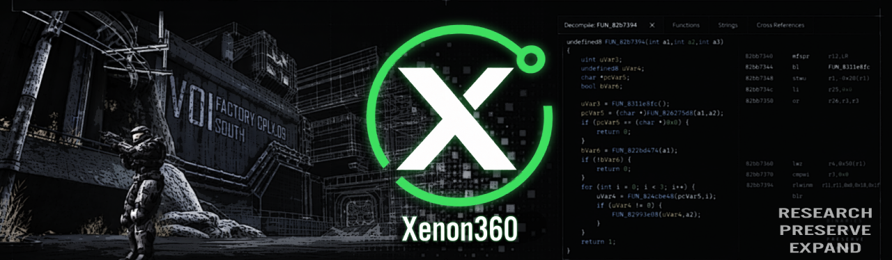

<p align="center">
  
</p>

# Xenon360

Xenon360 0.8.2 adds Xbox 360 executable support to **Ghidra 12.1.4 and 12.2**: an XEX/XEXP loader, a Xenon PowerPC/VMX128 language, import naming, native PDB/XDB symbols, automatic compiler-helper modeling, bounded switch recovery, and validated Havok metadata identification.

Xenon360 is an independent open-source project. It is not affiliated with, sponsored by, or endorsed by Microsoft, Havok, or Valve Corporation. References to these technologies are for compatibility, identification, and technical research only.

Xbox, Xbox 360, Direct3D, and DirectX are trademarks of the Microsoft group of companies. Havok and Havok Physics are trademarks of Havok. Valve and Source are trademarks of Valve Corporation. All other trademarks are the property of their respective owners.

## Install

Use the extension ZIP built for your Ghidra version. In Ghidra's project window, open **File > Install Extensions**, click **+**, and select the ZIP. Restart Ghidra, import your executable using **Xenon360 XEX**, and run Auto Analysis.

No build tools, PowerShell, or follow-up repair scripts are required to use the extension. The ZIP contains Java classes and language data, not host-specific executables.

Keep a backup of existing projects and their original extension package. Validate 0.8.2 using a fresh import or a project copy; opening an old project in a newer Ghidra can migrate it. Never use a project upgraded by 12.2 to test 12.1.4. The Xenon language revision remains 1.1; retain a project backup before accepting Ghidra's language upgrade.

| Ghidra | Required JDK | Extension ZIP |
|---|---|---|
| 12.1.4 | 21 | `ghidra_12.1.4_XenonVMX128_0.8.2.zip` |
| 12.2 | 25 | `ghidra_12.2_XenonVMX128_0.8.2.zip` |

The two packages are built independently against their respective Ghidra release. They are not interchangeable. Verify the download against its accompanying SHA-256 file.

If Ghidra asks to configure new extension plugins, enable **XenonAnalysisPlugin**. It can also be enabled in **File > Configure > Configure All Plugins**, under Analysis. Its actions appear in the CodeBrowser's **Tools > Xenon360** menu.

## Integrated analysis and evidence

Normal Auto Analysis enables **Xenon360 Compiler Helpers** and **Xenon360 Havok Metadata**. Both are cancellable and re-runnable. Partial memory selections are deferred: rerun against the full program. The analysis log records recognized structures, withheld ownership conflicts, and remaining helper flow overrides.

**Xenon360 Bounded Switch Tables** also runs automatically. It recognizes validated read-only byte-offset and unsigned-halfword relative-offset switch-table patterns with unsigned range guards and strict target validation. It restores missing case edges and only extends default-named function bodies into validated unowned code. User symbols, defined data, conflicting owners and unknown patterns are preserved. Exports include the table address, guard-derived count, scale and exact targets.

The helper analyzer preserves established functions and symbols. **Repair CALL_RETURN at exact save helpers** is an advanced option, disabled by default because Ghidra does not retain flow-override authorship. Enable it only when those overrides are known analysis artifacts. It only repairs direct linked branches whose bytes and exact helper destination agree.

Havok recognition checks retained names, scoped names, executable callbacks, mapped vtables, and supported metadata layouts. Legacy Xenon records additionally require a corroborating constructor vptr store. Safe metadata labels and descriptor types are automatic. **Create unowned validated callback functions** recovers a missing function only after a complete control-flow check within 256 bytes, preserving existing ownership, code, data, and names. **Name validated callback functions** is disabled by default. It names only default-named entries with a unique class/role identification and a recorded binary hash. Shared callbacks and established names are withheld. PC instance layouts and prototypes are never copied to Xbox 360.

- **Export Analysis Evidence...** chooses a JSON output file. It records the binary hash, one recommended name per function, source, SDK version evidence or `UNKNOWN`, confidence, application status, imports, and native BSim features when available.
- **Compare Reference Evidence...** compares user-selected local evidence exports and writes a review-only report. It never automatically applies candidate names, types, or prototypes. No particular title, program binary, or proprietary SDK is required.

No BSim server, external API, Havok SDK installation, or network service is required. Scans are bounded to 512 MiB of initialized bytes, 256 MiB per block, and 256 callback signatures per export (five seconds per function). Unsupported metadata, missing boundaries, and partial native signatures are explicitly reported. The x64 recognizer currently handles a narrow, independently checked static-initializer form.

This is identification of retained metadata and loaded-object callbacks. World/solver/collision function families, arbitrary virtual tables, and missing reflection data are not guessed. A Havok version string identifies retained metadata, not necessarily the exact linked SDK build.

For XEXP patches, select the matching source executable with the **Base XEX** picker. For native symbols, use the **PDB/XDB** picker. The default `public-symbols` mode loads types and public symbols; `all` enables Ghidra's full Universal PDB analysis.

## Supported formats

XEX0, XEX?, XEX%, XEX-, XEX1, XEX2, and XEXP/DELTA are supported, including NONE, BASIC, and NORMAL/LZX reconstruction and the supported retail/development encryption variants.

The language ID is `PowerPC:BE:64:Xenon-VMX128-32addr`. The module remains named `XenonVMX128` to preserve existing project bindings.

Unknown imports retain deterministic module-and-ordinal names. Conflicting legacy ordinal observations are not assigned a guessed name. Native symbol loading checks GUID, age, processor identity, and file integrity before application.

## Ghidra on macOS

Use a working Ghidra installation with its native components built for your Mac. Follow Ghidra's **Getting Started > Building Native Components** instructions when needed. The Xenon360 ZIP itself is unchanged across platforms. Qualification covers Windows builds and synthetic tests, with Linux qualification performed by the release workflow. macOS has not been qualified. A workflow configuration alone does not establish a passing run.

## Build from source

Requirements: official Ghidra 12.1.4 with JDK 21, or Ghidra 12.2 with JDK 25. The same source and Gradle build are used on Windows, Linux, and macOS. Gradle 9.1.0 satisfies both releases' minimum requirements (8.5 and 9.1 respectively).

Windows:

```bat
.\gradlew.bat "-PGHIDRA_INSTALL_DIR=C:\Tools\ghidra_12.2_PUBLIC" buildExtension smokeTest
```

Linux and macOS:

```sh
./gradlew -PGHIDRA_INSTALL_DIR=/path/to/ghidra_12.2_PUBLIC buildExtension smokeTest
```

`GHIDRA_INSTALL_DIR` may also be set as an environment variable. Set `JAVA_HOME` to select a JDK. Paths containing spaces must be quoted.

The build prepares the Xenon language, compiles the extension, runs parser/patch/import/Havok tests, and creates `dist/ghidra_12.2_XenonVMX128_0.8.2.zip` with a SHA-256 checksum file. `smokeTest` also installs that ZIP in an isolated settings directory, imports a synthetic XEX, runs native decompilation and VMX p-code, and tests cancellation, ownership, renaming, idempotency, and BSim evidence. It does not change your installed extension or Ghidra projects.

The wrapper downloads Gradle 9.1.0 on first use and verifies its SHA-256 checksum. Later builds use the cached distribution. No Xbox SDK or game files are needed. An offline machine needs the pinned Gradle distribution cached or installed in advance; `--offline` does not download the wrapper distribution for you.

## Tests

`buildExtension` runs the standalone regression tests and checks language preparation with both LF and CRLF line endings. To also import a synthetic XEX in a disposable Ghidra instance, run:

```sh
./gradlew -PGHIDRA_INSTALL_DIR=/path/to/ghidra buildExtension smokeTest
```

Use `gradlew.bat` on Windows. The smoke test installs only inside `build/smoke`, verifies automatic helper modeling, and never runs a repair script. Its logs are kept there. This does not replace visual testing of the import dialogs or analysis of real executables.

Optional developer validation scripts accept user-provided files and write results in isolated project directories. They are not required for normal installation. Proprietary validation inputs and private research logs are not included.

VMX tests execute native p-code without emulated userop callbacks. Exact fused floating point, estimate, saturation, and compare-record behavior remains opaque where the language still emits a userop; mnemonic coverage does not imply hardware equivalence.

Version 0.8.1 corrects `lvrx128` decoding where later PowerISA instructions previously occupied Xenon encodings. It also supplies native integer lane semantics for `vpermwi128` and `vrlimi128`. The changes do not add automatic SDK-based function naming. See `docs/0.8.1-engineering.md` for public processor tests and limitations.

Version 0.8.2 extends the existing bounded switch analyzer with guarded, unsigned 16-bit relative tables. It validates the physical register flow, every destination and reachable instruction, and nested supported dispatches before changing anything. Recovery preserves existing function names and owners, rolls back on cancellation, and requests normal analysis of the recovered function. Arbitrary multi-block dispatches and writable tables remain outside this fallback. See `docs/0.8.2-engineering.md` for the comparison and limits.

## Source handling

Evidence exports are local files selected by the user. They contain the imported program's name, hashes, symbols, addresses and analysis findings. Review them before sharing. The extension makes no network requests and contains no telemetry; optional native Ghidra services retain their own settings.

Xenon360 does not execute game code or modify source executables. Patches are reconstructed in memory.

The repository and release package do not include game executables, game code, game symbols, Xbox SDK files, or other proprietary runtime content. Users supply their own XEX/XEXP files and, when available, their own PDB/XDB symbol files.

Signature and hash checks are recorded as diagnostics; older integrity schemes are not treated as modern XEX2 validation.

Third-party notices are in [THIRD_PARTY_NOTICES.md](THIRD_PARTY_NOTICES.md), with license texts under [licenses](licenses/).

## First import

1. Create a disposable local Ghidra project and choose **File > Import File**.
2. Select an executable you are authorized to analyze. Confirm **Xenon360 XEX** and the Xenon language shown above.
3. Leave optional symbol fields empty when no matching PDB/XDB is available. XEXP patches require the matching base executable.
4. Open the imported program and accept normal Auto Analysis. Keep native switch analysis enabled and allow an adequate decompiler timeout.
5. Inspect the analysis log and Tools > Xenon360 evidence export. Recovered metadata is evidence, not proof of exact SDK identity or hardware behavior.

## Uninstall and troubleshooting

Close open programs, use **File > Install Extensions** to mark XenonVMX128 for removal, and restart Ghidra. Keep project backups: removing an extension does not undo changes already saved in a project. Reinstall the matching ZIP and restart to reopen projects that require the Xenon language.

- **Version mismatch:** install the ZIP for the exact Ghidra version. Set `JAVA_HOME` to the JDK in the matrix when building.
- **Loader or language missing:** restart after installation and check for duplicate XenonVMX128 installations. The extension includes its loader; a separate XEX loader is unnecessary.
- **Optional SDK or symbols unavailable:** ordinary XEX loading, VMX decoding and bounded analysis work without them. Incorrect symbol identities are rejected.
- **Incomplete decompilation:** inspect warnings, ownership conflicts and unsupported instructions. Increase an inadequate native decompiler budget before retrying a fresh import. Timeouts and unsupported switch shapes may leave control flow incomplete; bounded fallback recovery does not guarantee every switch will be recovered.
- **Build failure:** preserve `build/smoke` logs and receipts. A headless process exit code alone does not establish test success. Paths containing spaces are supported when quoted.

The source archive contains all extension source, license notices and portable synthetic tests, without Git history or private research inputs. Rebuild in two fresh directories with the same Ghidra distribution and JDK, run `buildExtension smokeTest`, then compare the ZIP SHA-256 values. Archive timestamps and file order are deterministic. Source checkout line endings are defined in `.gitattributes`.

## License

Copyright 2026 EveryoneEverybody.

Xenon360 is licensed under the Apache License 2.0. See [LICENSE](LICENSE). Third-party components and derived material remain under their original licenses as listed in [THIRD_PARTY_NOTICES.md](THIRD_PARTY_NOTICES.md).
